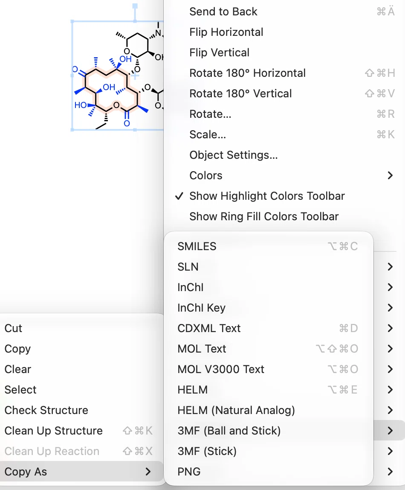
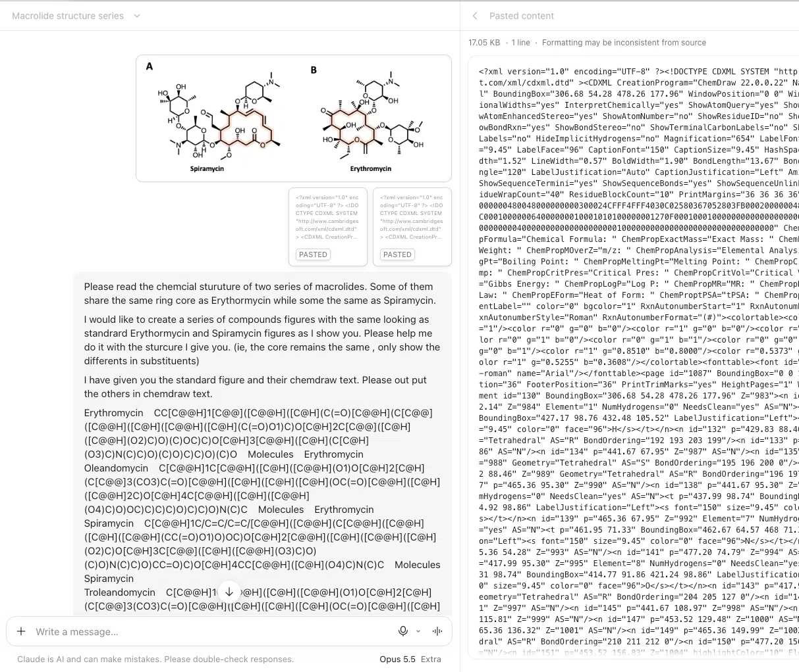

# Drawing ChemDraw Chemical Structures with AI LLMs

As the title says, here is the situation:

When we use ChemDraw to draw a series of molecules sharing a similar scaffold, copying and pasting SMILES directly, or downloading mol/sdf files straight from the web, often makes it hard to keep their scaffold layouts looking exactly the same. For example, a substituent on the same scaffold is sometimes drawn above and sometimes below; adjusting everything by hand is a real pain.

So I tried to see whether, with the help of AI, one could directly generate a uniform output that imports into ChemDraw (or other structure-drawing software) seamlessly.

After exploring ChemDraw, I found that when copying a molecular structure, besides the familiar MOL, SMILES and InChI, we can also choose to copy it as “CDXML Text”. This is ChemDraw's proprietary encoding format. All we need to do is feed this CDXML text together with a well-written prompt to the AI, and the structures it generates are quite beautiful — not only is the scaffold aligned perfectly, but even details such as the colour scheme, bond length and bond width match the template molecule exactly.

Shared here for friends with similar needs.

