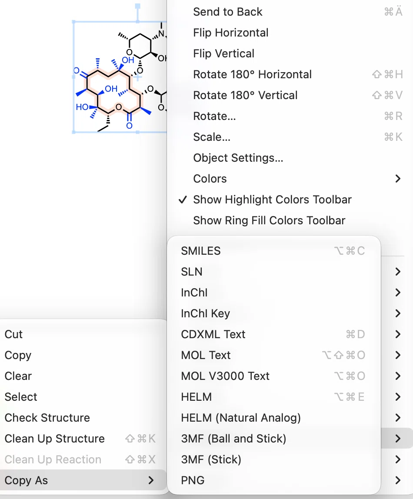
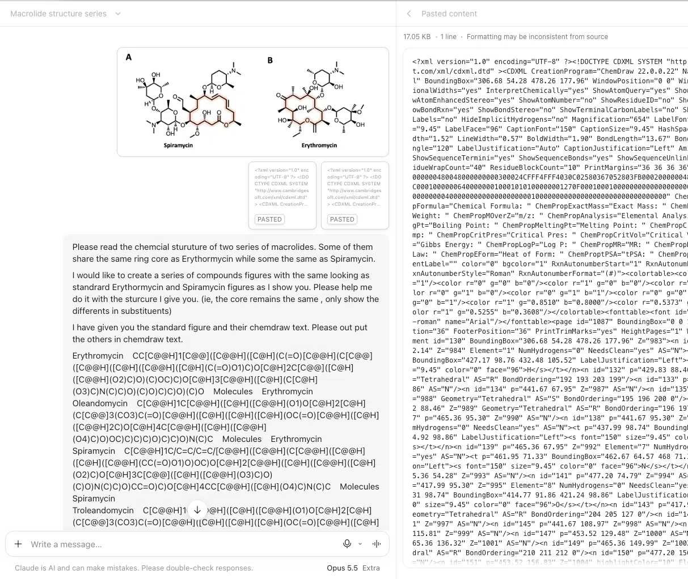

# 用AI 大模型繪製ChemDraw 化學結構

如题，情况是这样的：

我们在用ChemDraw绘制一系列具有相似Scaffold的分子时，如果直接复制粘贴SMILES，或者直接从网上下载mol/sdf文件，往往很难保证它们的骨架排版看起来完全一致。比如，同一个骨架上的某个取代基，有时被画在上方，有时在下方，如果全靠手动调整会非常讨嫌。

因此，笔者尝试了能不能借助AI，直接生成一种能无缝导入ChemDraw（或其他结构绘制软件）的统一输出。

探索ChemDraw后发现，我们在复制分子结构时，除了常见的MOL、SMILES、InChI之外，还可以选择复制为“CDXML Text”。这是ChemDraw专属的编码格式。我们只需把这段CDXML文本配合写好的prompt喂给AI，它生成的结构相当精美——不仅骨架完美对齐，甚至连配色、键长、键宽等细节都能和模板分子一模一样。

供有相似需求的朋友们参考

